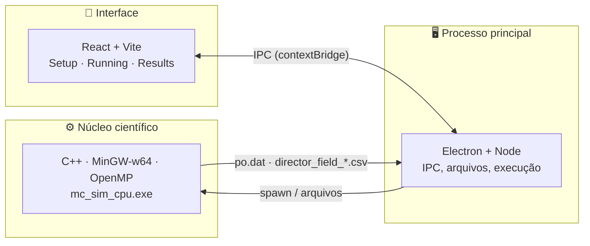

<div align="center">

<picture>
  <source media="(prefers-color-scheme: dark)" srcset="apps/desktop/renderer/src/assets/logo-dark.png">
  
</picture>

### Simulador de Monte Carlo para Cristais Líquidos
#### Edição Windows

Um ambiente desktop completo — física, computação de alto desempenho e visualização científica —
para simular, explorar e entender sistemas de cristais líquidos nemáticos.

[](https://github.com/kamakawa)

[](#-como-rodar-no-windows)
[](#-tecnologias)
[](#-internacionalização)
[](#-tecnologias)
[](#-tecnologias)

**[Funcionalidades](#-funcionalidades)** ·
**[Como rodar no Windows](#-como-rodar-no-windows)** ·
**[Problemas comuns](#-problemas-comuns)** ·
**[Arquitetura](#-arquitetura)**

</div>

<br>

> **Esta é a edição para Windows do [McLiCS](https://github.com/kamakawa/McLiCS).** O código-fonte é
> o mesmo do projeto original (que roda em Linux, com suporte a GPU/CUDA); aqui o foco é compilar e
> executar tudo no Windows. O mesmo `Makefile` funciona nos dois sistemas e detecta qual está em uso.
>
> **Limitação atual:** no Windows só o modo **CPU** está disponível. O botão de GPU fica desativado e a
> interface mostra um aviso. Veja [por que não há GPU no Windows](#-sobre-o-modo-gpu).

<br>

## 🔬 Sobre o projeto

**McLiCS** (*Monte Carlo simulator for Liquid Crystal Systems*) é um software científico que simula
a física de cristais líquidos nemáticos em rede, usando métodos de **Monte Carlo** e **minimização de
energia**. Ele nasceu como projeto de **Iniciação Científica** e cresceu para um ambiente completo:
configurar uma simulação, rodá-la, acompanhar sua execução ao vivo, e explorar os resultados —
inclusive a rede de diretores inteira em **3D**, interativamente — tudo em um único app.

Cristais líquidos ocupam o espaço entre líquidos comuns e sólidos cristalinos, e são a base de
tecnologias como displays (LCD) e sensores ópticos. O McLiCS modela esse comportamento em nível
microscópico — orientação molecular, parâmetro de ordem, transições de fase — e traduz os resultados
em algo que se pode literalmente girar na tela e entender.

<br>

## ⚙️ Funcionalidades

| | |
|---|---|
| 🧊 **Visualização 3D interativa** | O campo diretor completo renderizado em WebGL — órbita, zoom, cortes por plano, destaque automático de defeitos e uma linha do tempo para assistir a rede evoluir ao longo da simulação. |
| ⚡ **Simulação em CPU** | O núcleo é compilado com MinGW-w64 e paraleliza com OpenMP, usando todos os núcleos do processador. O executável é estático e não precisa de DLLs extras. |
| 📊 **Análise automática** | Resumo executivo gerado a partir do `po.dat` — médias, extremos e estimativa de transição de fase — além dos gráficos completos de S(T) e E(T) com faixa de incerteza. |
| 📁 **Organização por execução** | Cada simulação vira uma pasta própria em `Documentos\McLiCSRuns\`, com todos os arquivos, snapshots e parâmetros preservados. |
| 📝 **Notas + relatório em PDF** | Anotações do pesquisador exportadas junto com gráficos e parâmetros em um relatório pronto para compartilhar. |
| 🌍 **Multilíngue** | Interface completa em 6 idiomas: Português, Inglês, Espanhol, Francês, Japonês e Chinês, com as bandeiras desenhadas em SVG para aparecerem corretamente no Windows. |
| 🌙 **Modo escuro/claro** | Tema adaptado em todas as telas, incluindo a visualização 3D e as barras de rolagem. |
| 🧭 **Guia de parâmetros embutido** | Explicação de cada parâmetro físico direto no formulário, sem precisar sair do app. |

<br>

## 🚀 Como rodar no Windows

Testado no **Windows 11** com Node.js 22, MSYS2 (MinGW-w64, GCC 15) e Python 3.13.

### Pré-requisitos

| Ferramenta | Para quê | Onde obter |
|---|---|---|
| **Node.js** 20.19+ (ou 22.12+) | Interface (Vite 7) e Electron | [nodejs.org](https://nodejs.org/) |
| **MSYS2** em `C:\msys64` | `make` e `g++` que compilam o núcleo científico | [msys2.org](https://www.msys2.org/) |
| **Python 3** (com o launcher `py`) | Prévias 2D do campo diretor | [python.org](https://www.python.org/downloads/windows/) |
| **Git** | Clonar o repositório | [git-scm.com](https://git-scm.com/download/win) |

**1. Pacotes do MSYS2.** Abra o terminal **MSYS2 MinGW x64** (não o MSYS2 MSYS) e rode:

```bash
pacman -S --needed make mingw-w64-x86_64-gcc mingw-w64-x86_64-gsl
```

> Instalou o MSYS2 em outra pasta? Defina a variável de ambiente `MSYS2_ROOT` apontando para ela.
> O app usa `<MSYS2_ROOT>\usr\bin\make.exe` e `<MSYS2_ROOT>\mingw64\bin\g++.exe`.

**2. Bibliotecas Python** (PowerShell):

```powershell
py -3 -m pip install numpy matplotlib
```

### Passo a passo

```powershell
# 1. Clonar o repositório
git clone https://github.com/kamakawa/MClist-Windows.git
cd MClist-Windows

# 2. (Opcional) Compilar o núcleo científico agora, para conferir se o ambiente está certo
$env:PATH = "C:\msys64\mingw64\bin;C:\msys64\usr\bin;$env:PATH"
cd backend
make CPU                 # gera backend\dist\win-x64\mc_sim_cpu.exe
cd ..

# 3. Instalar e rodar a interface (renderer) — deixe este terminal aberto
cd apps\desktop\renderer
npm install
npm run dev

# 4. Em OUTRO terminal, instalar e rodar o app desktop
cd apps\desktop\main
npm install
npm start
```

Em modo de desenvolvimento, **cada execução recompila o núcleo automaticamente** antes de rodar, usando
o `make` e o `g++` do MSYS2. A primeira compilação leva alguns instantes; as seguintes só recompilam
o que mudou. Os resultados ficam em `Documentos\McLiCSRuns\run_<número>\`.

### Gerar um instalador

```powershell
cd apps\desktop\main
npm run dist:win         # instalador .exe (NSIS) em apps\desktop\main\dist
npm run dist:dir         # só a pasta do app, sem instalador (mais rápido para testar)
```

O instalador já leva o `mc_sim_cpu.exe` dentro, então **quem instala não precisa do MSYS2**. Ele
continua precisando de **Python 3 com `numpy` e `matplotlib`** para as prévias 2D.

> Antes de gerar o instalador, compile o núcleo (`make CPU`) para existir o `mc_sim_cpu.exe` que o
> script de empacotamento copia.

<br>

## 🩹 Problemas comuns

<details>
<summary><b>A simulação falha logo ao iniciar, com erro de compilação</b></summary>

O MSYS2 não foi encontrado ou faltam pacotes. Confira que existe `C:\msys64\usr\bin\make.exe` (ou
defina `MSYS2_ROOT`) e que os pacotes `make`, `mingw-w64-x86_64-gcc` e `mingw-w64-x86_64-gsl` estão
instalados (comando `pacman` acima). A mensagem aparece na tela *Running*.
</details>

<details>
<summary><b><code>make</code> reclama de "Cannot create temporary file in C:\WINDOWS"</b></summary>

Foi observado ao chamar o `make` do MSYS2 a partir do Git Bash. Rode a compilação pelo
**PowerShell** com o `PATH` ajustado (como no passo 2 acima) ou pelo terminal **MSYS2 MinGW x64**.
</details>

<details>
<summary><b>As imagens de prévia não aparecem na tela <i>Running</i></b></summary>

Confirme que o Python está instalado e que o launcher `py` funciona (`py -3 --version`) e instale as
bibliotecas: `py -3 -m pip install numpy matplotlib`. Se usar outro Python, defina a variável de
ambiente `PYTHON` com o caminho do executável.
</details>

<details>
<summary><b>O Electron abre e fecha na hora (erro <code>Cannot read properties of undefined (reading 'whenReady')</code>)</b></summary>

A variável de ambiente `ELECTRON_RUN_AS_NODE` está definida no seu terminal, o que faz o Electron
rodar como Node puro. Remova-a antes de iniciar:

```powershell
Remove-Item Env:ELECTRON_RUN_AS_NODE
npm start
```
</details>

<details>
<summary><b>Mudei o <code>main.js</code> e nada mudou no app</b></summary>

O Electron só lê o `main.js` ao abrir. Feche a janela e rode `npm start` de novo. Mudanças na pasta
`renderer` entram sozinhas (Vite); basta recarregar com <kbd>Ctrl</kbd>+<kbd>R</kbd>.
</details>

<details>
<summary><b>Erros estranhos de sintaxe no <code>Makefile</code></b></summary>

O `Makefile` precisa de quebras de linha no formato Linux (LF). O repositório já traz um
`.gitattributes` que força isso ao clonar. Se o arquivo veio com quebras do Windows (CRLF) por algum
motivo, clone o repositório novamente em uma pasta limpa.
</details>

<br>

## 🎮 Sobre o modo GPU

O núcleo científico existe em duas versões: CPU (OpenMP) e GPU (CUDA). No Linux as duas funcionam. No
Windows, o compilador de CUDA (`nvcc`) só trabalha em conjunto com o compilador da Microsoft (**MSVC**),
que não se mistura com o `g++` (MinGW) usado no resto do núcleo. Por isso, nesta edição:

- o botão **Executar GPU** fica desativado, com um aviso na tela de configuração;
- todo o restante — simulação, prévias, visualização 3D, relatórios — funciona em CPU.

Habilitar a GPU no Windows exige compilar o núcleo inteiro com MSVC + CUDA (por exemplo via CMake), o
que está no [roteiro](#-estado-atual).

<br>

## 🧬 Sobre a física

O McLiCS trabalha com um modelo de rede (*lattice model*) onde cada sítio guarda um **diretor**
molecular. A evolução do sistema segue **mecânica estatística** via Monte Carlo, sob diferentes
potenciais de interação e geometrias:

- **Potenciais:** Lebwohl–Lasher, GHRL (elástico generalizado) e Selinger/Pear
- **Geometrias:** bulk, slab, esfera e geometrias customizadas via arquivo de contorno
- **Ancoragem de superfície:** homeotrópica, planar e variantes acopladas ao GHRL
- **Modos de evolução:** variação térmica, degraus de temperatura, *quench* e campo elétrico

Grandezas analisadas: **parâmetro de ordem (S)**, **energia (E)**, **temperatura** e **transições de
fase** — tudo exportado em `po.dat` e nos snapshots `director_field_*.csv` que alimentam a
visualização 3D.

<br>

## 🏗️ Arquitetura

Três camadas independentes, cada uma fazendo só o que faz de melhor:



O backend não sabe nada sobre interface — ele só lê um `param.txt` e escreve `.dat`/`.csv`. O processo
principal do Electron orquestra a execução e faz a ponte segura com o sistema de arquivos. O
renderer nunca toca em disco ou processos diretamente: tudo passa pela API exposta via
`contextBridge`, com verificação de caminho em toda leitura de arquivo.

**O que muda no Windows**

| Ponto | Linux | Windows |
|---|---|---|
| Compilação do núcleo | `g++` + `make` do sistema | `g++` + `make` do **MSYS2** (`C:\msys64`) |
| Executável gerado | `backend/dist/linux-x64/mc_sim_cpu` | `backend/dist/win-x64/mc_sim_cpu.exe` |
| Modo GPU (CUDA) | disponível | indisponível (veja [acima](#-sobre-o-modo-gpu)) |
| Prévias 2D | `python3` | `py -3` (ou a variável `PYTHON`) |
| Instalador | `.AppImage` / `.deb` (`dist:linux`) | `.exe` NSIS (`dist:win`) |

<br>

## 🧱 Tecnologias

<table>
<tr>
<td valign="top">

**Núcleo científico**
<p>

</p>
GSL · OpenMP · MinGW-w64 · Makefile

</td>
<td valign="top">

**Desktop**
<p>


</p>
electron-builder · IPC seguro (contextBridge)

</td>
<td valign="top">

**Interface**
<p>


</p>
React Router · Three.js (WebGL) · CSS custom properties

</td>
</tr>
</table>

<br>

## 🌍 Internacionalização

| 🇺🇸 Inglês | 🇧🇷 Português | 🇪🇸 Espanhol | 🇫🇷 Francês | 🇯🇵 Japonês | 🇨🇳 Chinês |
|---|---|---|---|---|---|

Toda a interface — incluindo o guia de parâmetros e o relatório em PDF — está traduzida nos seis
idiomas acima. No Windows as bandeiras do seletor são desenhadas em SVG, já que o sistema não exibe
emojis de bandeira.

<br>

## 🗺️ Estado atual

- [x] Simulação em CPU no Windows (MinGW-w64 + OpenMP)
- [x] Compilação automática do núcleo em modo de desenvolvimento
- [x] Múltiplas geometrias, potenciais e condições de ancoragem
- [x] Visualização 3D interativa do campo diretor
- [x] Relatórios em PDF com análise automática
- [x] Interface em 6 idiomas, modo claro/escuro
- [x] Empacotamento configurado para Windows (`dist:win`)
- [ ] Modo GPU (CUDA) no Windows — requer build com MSVC + CMake
- [ ] Empacotamento para macOS

<br>

---

<div align="center">

### 👨‍💻 Desenvolvido por [Eric Kamakawa](https://github.com/kamakawa)

**Engenharia de Computação — UTFPR**

👨‍🏫 Orientação: **Dr. Rafael Zola** e **Dr. Rodolfo Teixeira**

<br>

*Física + Computação + Engenharia.*

</div>
